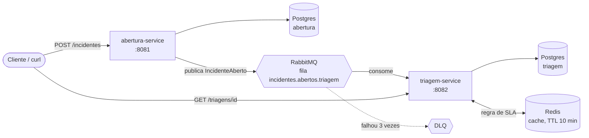

# Central de Incidentes

Projeto final do módulo. **Perfil de execução: A (com Docker).**

## O que o sistema faz

Quando alguém abre um incidente de TI ("o internet banking caiu"), o sistema:

1. **registra** o incidente (`abertura-service`);
2. **avisa por uma fila** que há um incidente novo;
3. **faz a triagem** (`triagem-service`): calcula a prioridade (P1 a P4) pela matriz impacto x urgência e o prazo-limite para resolver (SLA);
4. usa um **cache** para não consultar no banco, a cada incidente, a regra de SLA, que quase nunca muda.

Em uma frase: é o balcão que anota o problema, separado da equipe que decide o quanto ele é grave.

## Desenho



O mesmo desenho, em texto:

```
cliente --POST--> [abertura-service] --grava--> (Postgres abertura)
                        |
                        | publica "IncidenteAberto"
                        v
                  {{ RabbitMQ }} ---falhou 3x---> {{ DLQ }}
                        |
                        | consome
                        v
                 [triagem-service] --grava--> (Postgres triagem)
                        ^
                        +--- regra de SLA <--> (Redis, TTL 10 min)
```

| Requisito do enunciado | Onde está |
|---|---|
| 2 serviços, cada um com o seu banco | `abertura-service` + `abertura-db`; `triagem-service` + `triagem-db` (ver `docker-compose.yml`) |
| 1 fila; mensagem repetida grava uma vez só | `PublicadorDeIncidentes` → RabbitMQ → `IncidenteAbertoListener` / `TriagemService` |
| 1 cache: o que guarda, por quanto tempo, quando apaga | `CacheConfig` e `RegraSlaService` (triagem-service) |
| ADRs | [`docs/adr/`](docs/adr/) |
| Além do obrigatório | retry + DLQ (ADR 0005) |

## Como rodar (perfil A)

Pré-requisito: Docker Desktop aberto. Não precisa de Java nem de Maven instalados; a compilação acontece dentro do Docker.

```bash
docker compose up --build
```

A primeira vez demora alguns minutos (baixa imagens e dependências). Está pronto quando os dois serviços mostrarem `Started ...Application`.

Em outro terminal:

```bash
./scripts/demo.sh
```

O script percorre o fluxo inteiro: abre um incidente, mostra a triagem, envia a mesma mensagem mais duas vezes (e mostra que nada duplicou) e demonstra o cache sendo criado, apagado e recriado.

Para parar e apagar os dados: `docker compose down -v`.

### Na mão, passo a passo

```bash
# 1. abrir um incidente
curl -s -X POST localhost:8081/incidentes -H 'Content-Type: application/json' \
  -d '{"titulo":"Internet banking fora do ar","impacto":"ALTO","urgencia":"ALTO"}'

# 2. ver a triagem (troque <id> pelo id devolvido acima)
curl -s localhost:8082/triagens/<id>

# 3. mandar a mesma mensagem de novo e conferir que continua havendo uma triagem só
curl -s -X POST localhost:8081/incidentes/<id>/reenviar
curl -s localhost:8082/triagens

# 4. cache: ver a chave e o tempo de vida no Redis
docker compose exec redis redis-cli KEYS 'regras-sla*'
docker compose exec redis redis-cli TTL 'regras-sla::P1'

# 5. alterar a regra (apaga o cache daquela prioridade)
curl -s -X PUT localhost:8082/regras-sla/P1 -H 'Content-Type: application/json' -d '{"prazoMinutos":30}'
```

Painel do RabbitMQ: <http://localhost:15672> (usuário `incidentes`, senha `incidentes`).

## API

| Serviço | Método e caminho | O que faz |
|---|---|---|
| abertura (8081) | `POST /incidentes` | abre o incidente e publica na fila |
| | `GET /incidentes`, `GET /incidentes/{id}` | consulta |
| | `POST /incidentes/{id}/reenviar` | reenvia a mesma mensagem (para demonstrar a idempotência) |
| triagem (8082) | `GET /triagens`, `GET /triagens/{incidenteId}` | resultado da triagem |
| | `GET /regras-sla/{P1..P4}` | regra de SLA (passa pelo cache) |
| | `PUT /regras-sla/{P1..P4}` | altera a regra e apaga o cache dela |

## Testes

```bash
cd triagem-service && mvn test   # precisa de Java 25 e Maven; não precisa de Docker
```

## Estrutura

```
central-incidentes/
├── docker-compose.yml
├── abertura-service/      # serviço 1 (porta 8081, banco abertura-db)
├── triagem-service/       # serviço 2 (porta 8082, banco triagem-db)
├── scripts/demo.sh        # roteiro da demonstração
└── docs/
    ├── adr/               # as decisões e os porquês
    └── guia-de-estudo.md  # explicação de cada conceito e roteiro da banca
```

## Uso de IA

O código, os ADRs e a documentação foram gerados com apoio de IA (Claude). O checklist da conferência manual está em [`docs/guia-de-estudo.md`](docs/guia-de-estudo.md#7-uso-de-ia-o-que-conferir-à-mão).
